# Connecta — Plataforma de Recrutamento com Sistema de Match

**Protótipo de aplicativo mobile | UI/UX Design | Figma**

O **Connecta** é um projeto acadêmico de prototipagem de interfaces que propõe aproximar profissionais e empresas por meio de um sistema de **Match**, com foco em navegação intuitiva, visualização de oportunidades e recursos de acessibilidade.

> **Status:** protótipo visual no Figma. As telas representam fluxos e funcionalidades propostas; não correspondem, necessariamente, a um aplicativo implementado com autenticação, chat ou cálculo de compatibilidade reais.

**[▶ Acessar protótipo interativo no Figma](https://www.figma.com/proto/LBkmBIdxsqPi6jMWvURo18/Trabalho-Fabiano?node-id=16-188&p=f&t=j9se1l3xiE9zmQtq-1&scaling=scale-down&content-scaling=fixed&page-id=0%3A1&starting-point-node-id=1%3A876&show-proto-sidebar=1)**  

## 📌 Objetivo

Explorar uma experiência de recrutamento com duas jornadas conectadas: de um lado, o trabalhador descobre vagas e avalia sua compatibilidade; de outro, a empresa acompanha candidatos, organiza vagas e visualiza informações de recrutamento.

## 📱 Visão geral das interfaces

| Trabalhador — descoberta de vagas | Empresa — painel de recrutamento |
|:---:|:---:|
| 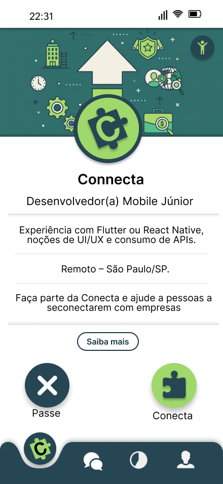 | 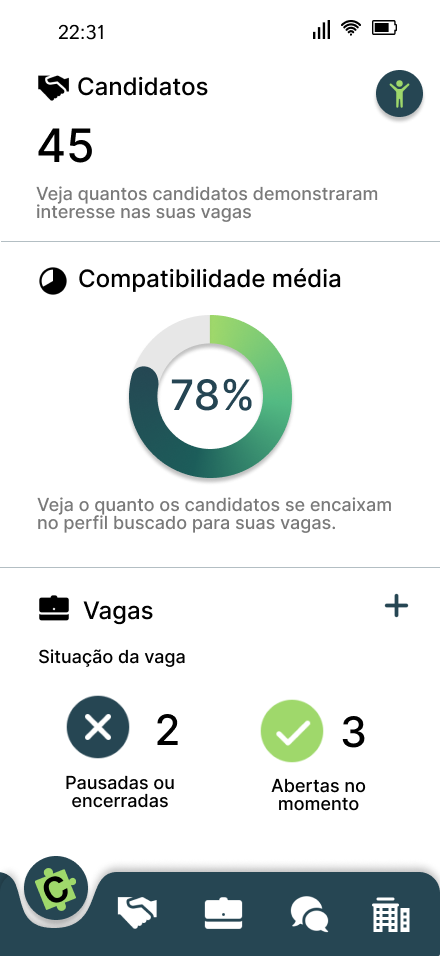 |
| *Interesse em vagas e navegação por oportunidades* | *Indicadores de candidatos, compatibilidade e vagas* |

## 👤 Jornada do trabalhador

As telas do trabalhador ilustram:

1. **Acesso à plataforma:** seleção do perfil Trabalhador e formulário de login.
2. **Descoberta de vagas:** apresentação de oportunidades com ações de passar ou demonstrar interesse.
3. **Detalhes da oportunidade:** consulta a descrição, responsabilidades e requisitos.
4. **Conversas:** interface de mensagens entre candidato e empresa.
5. **Compatibilidade:** apresentação visual de afinidade com empresas e oportunidades, incluindo um percentual ilustrativo.
6. **Perfil profissional:** visualização de dados e objetivo profissional.
7. **Configurações e acessibilidade:** preferências visuais e opções para diferentes necessidades.

| Compatibilidade | Acessibilidade |
|:---:|:---:|
| 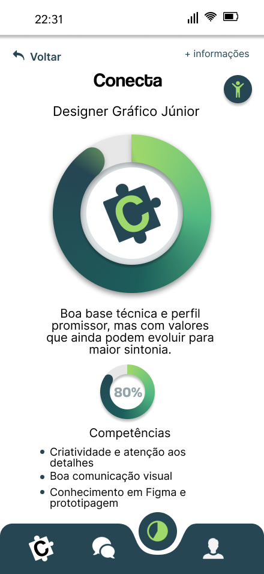 | 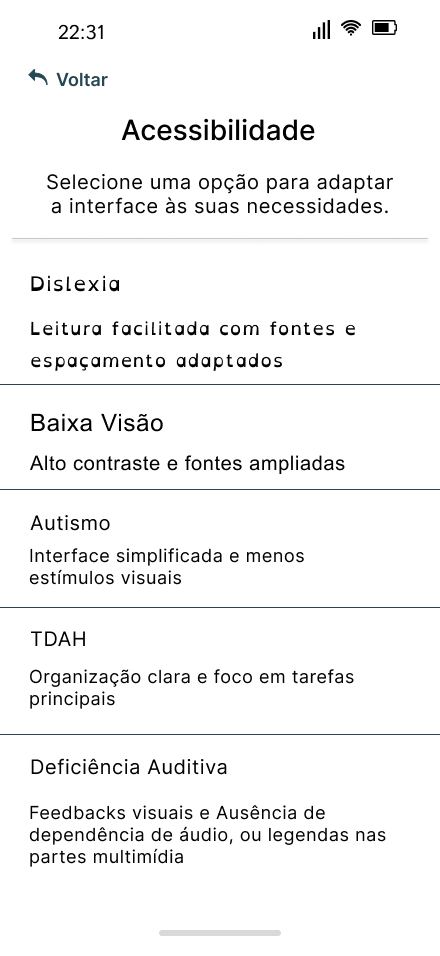 |
| *Exemplo de visualização de compatibilidade* | *Recursos de interface propostos para diferentes necessidades* |

<details>
<summary><strong>Ver todas as telas do trabalhador (10 imagens)</strong></summary>

| Tela | Imagem |
|---|---|
| Login | 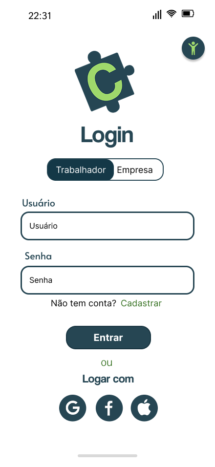 |
| Match |  |
| Detalhes da vaga | 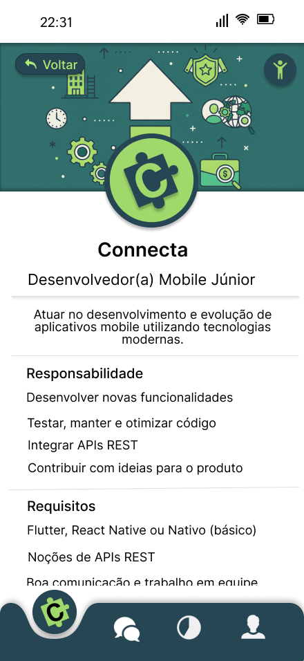 |
| Chat | 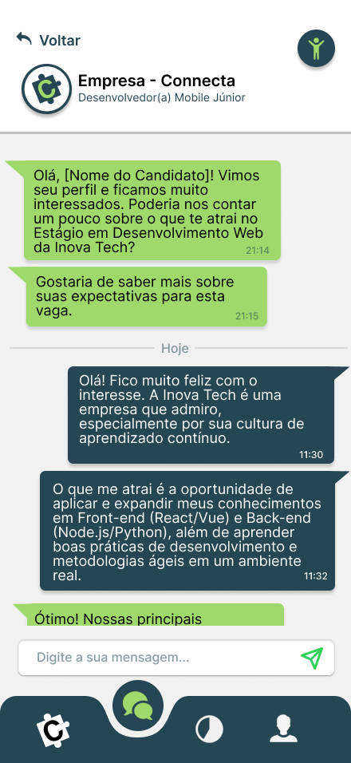 |
| Compatibilidade | 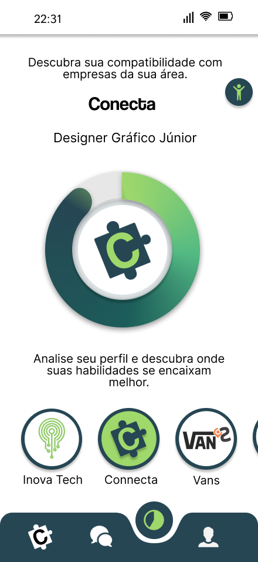 |
| Detalhes da compatibilidade |  |
| Perfil profissional | 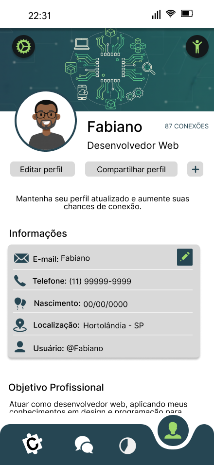 |
| Configurações | 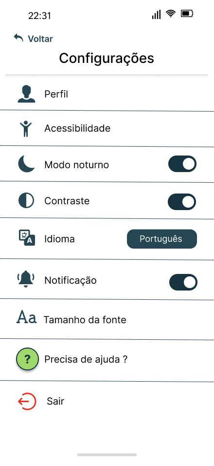 |
| Acessibilidade |  |
| Menu de acessibilidade | 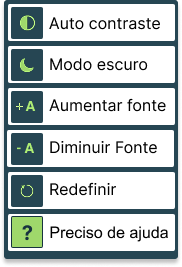 |

</details>

## 🏢 Jornada da empresa

As interfaces destinadas às empresas contemplam:

1. **Acesso empresarial:** formulário de login com CNPJ e senha.
2. **Dashboard:** resumo de candidatos, compatibilidade média e situação das vagas.
3. **Gestão de candidatos:** lista de perfis com busca, filtros, favoritos e acesso às conversas.
4. **Gestão de vagas:** visualização de oportunidades e ações de gerenciamento.
5. **Criação de vagas:** formulário com campos de capa, título, descrição, modelo de trabalho e localização.
6. **Mensagens:** listagem de conversas associadas a candidatos.
7. **Perfil institucional:** informações e apresentação da empresa.

| Candidatos | Gerenciamento de vagas |
|:---:|:---:|
| 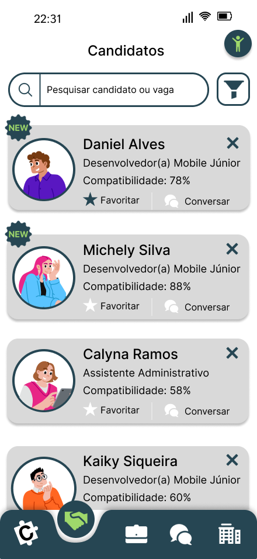 | 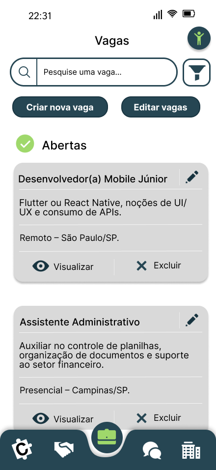 |
| *Perfis e indicadores de compatibilidade* | *Visualização de vagas e ações propostas* |

<details>
<summary><strong>Ver todas as telas da empresa (7 imagens)</strong></summary>

| Tela | Imagem |
|---|---|
| Login da empresa | 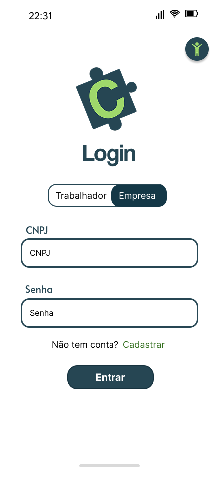 |
| Dashboard |  |
| Candidatos |  |
| Vagas |  |
| Criar vaga | 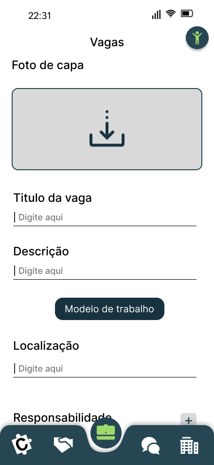 |
| Chat | 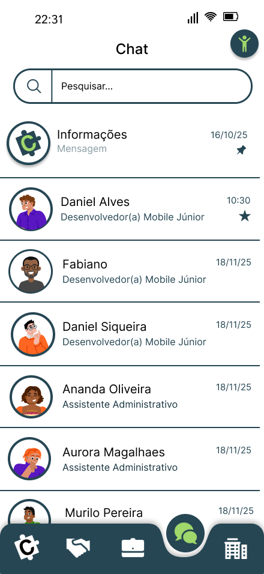 |
| Perfil da empresa | 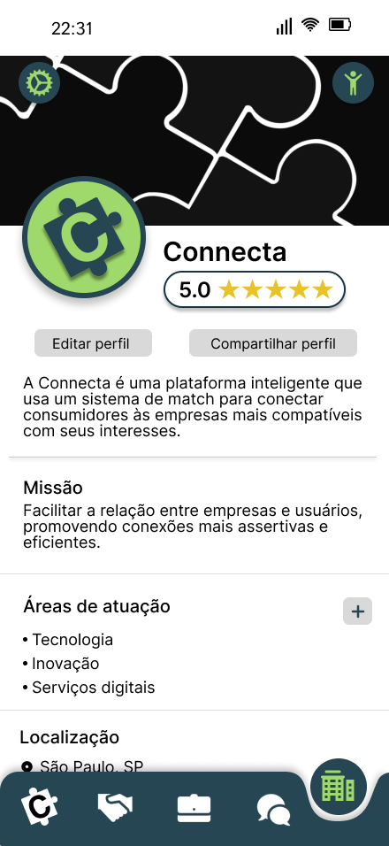 |

</details>

## ♿ Acessibilidade e experiência do usuário

A proposta visual contempla uma área dedicada à acessibilidade, com opções relacionadas a **dislexia, baixa visão, autismo, TDAH e deficiência auditiva**, além de controles de **contraste, modo escuro e tamanho da fonte**. Essas escolhas são apresentadas como **soluções de design propostas**, não como funcionalidades validadas por testes com usuários ou auditorias de acessibilidade.

O protótipo também diferencia as jornadas de trabalhador e empresa, mantendo navegação e ações adequadas a cada perfil.

## 🛠️ Ferramenta e conhecimentos envolvidos

- **Figma:** design das interfaces e prototipagem.
- **UI/UX Design:** organização de telas, fluxos e experiência de navegação.
- **Design de interação:** representação de ações como Match, busca, chat e gerenciamento de vagas.
- **Acessibilidade:** concepção de adaptações de interface para diferentes necessidades.

## 📂 Organização do repositório

```text
connecta-recruitment-app/
├── README.md
├── .gitignore
└── screenshots/
    ├── trabalhador/   # 10 telas da jornada do candidato
    └── empresa/       # 7 telas da jornada do recrutador
```

## 📚 Contexto acadêmico

O Connecta foi desenvolvido em equipe como parte de um projeto acadêmico do curso de Engenharia da Computação. O trabalho envolveu planejamento, organização de funcionalidades, prototipagem de interfaces e aplicação de conceitos de UI/UX, com foco na conexão entre candidatos e empresas..

## 👩‍💻 Autoria / contribuição:

Projeto acadêmico desenvolvido por **Giovanna Nunes Alexandre, Isabella Pires Matsumoto, Nicollas Victor Diocala Pereira, Mauricio Pereira Guardia Morais, Gabriel Henrique de Jesus, Joyce Gonçalves da Silva e Giovanna Teodoro Lofrani**, estudantes de Engenharia da Computação no Centro Universitário Adventista de São Paulo (UNASP).
Desenvolvido como aplicação prática dos conhecimentos de **UI/UX Design, prototipagem de interfaces, acessibilidade e experiência do usuário**, com o objetivo de propor uma solução digital que facilite a conexão entre candidatos e empresas por meio de um sistema de Match.